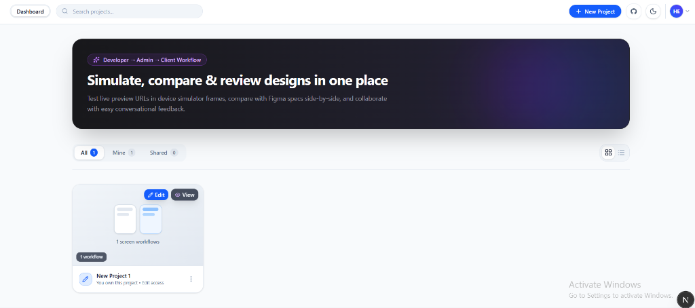
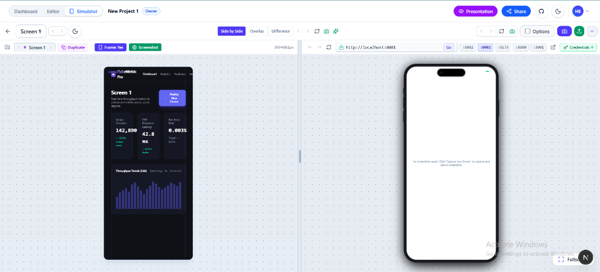
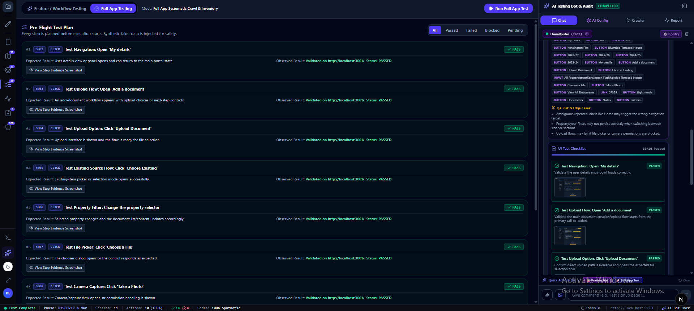
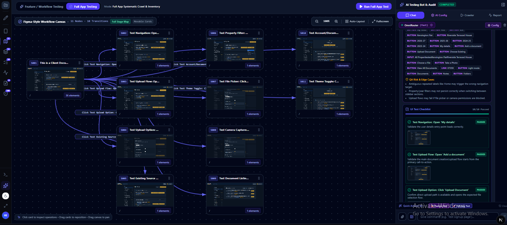
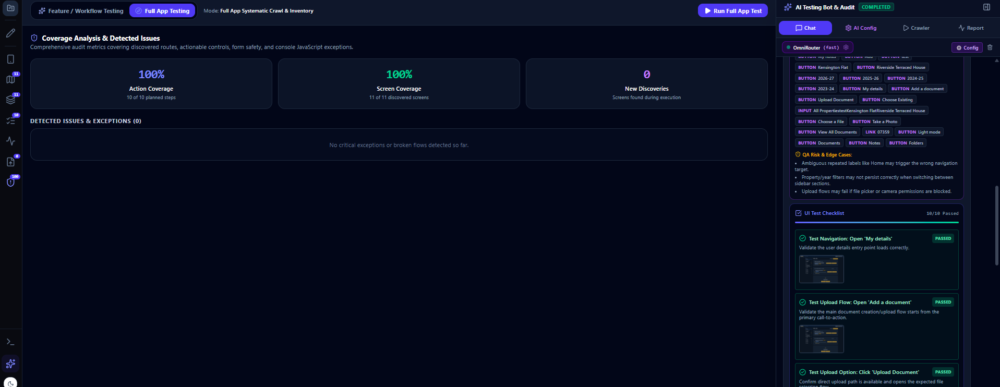

# 🎨 Open Design AI

> **Open-Source Design Review Platform & Autonomous Web Application Testing Simulator**  
> Streamline UI sign-offs with Figma comparisons, and automate systematic end-to-end application testing using autonomous AI browser agents.

[](LICENSE)
[](https://github.com/nareshbabunuli)
[](https://nextjs.org/)
[](https://www.typescriptlang.org/)
[](https://tailwindcss.com/)
[](https://supabase.com/)
[](CONTRIBUTING.md)

---

## 📸 Screenshots

### 🏠 Dashboard - Multi-Project Hub

*Organize client projects, track completion, manage team access, and launch presentation-ready reports.*

### 📱 Device Simulator - Figma vs Live

*Run live web URLs in responsive device frames side-by-side with your Figma design specs.*

### 🤖 AI Full App Testing

*AI bot crawls your entire app, generates a pre-flight test plan, executes every step, and reports pass/fail with evidence screenshots.*

### 🎨 Visual Flow Canvas

*Figma-style canvas of every discovered screen and navigation flow — auto-generated by the AI crawler.*

### 📊 Coverage Report

*Comprehensive coverage metrics: action coverage, screen coverage, detected issues, and QA risk edge cases.*

---

> [!NOTE]
> ### 📜 Open Source License & Project Attribution
> This project is licensed under the **MIT License**.
> - **Reuse is permitted**: You may use, modify, distribute, and commercially reuse the software, including in hosted services, subject to the MIT license terms.
> - **Preserve the legal notice**: Copies or substantial portions must include the copyright notice and MIT license text.
> - **Project credit**: This repository is maintained by [Naresh Babu Nuli](https://github.com/nareshbabunuli). Visible product attribution is appreciated, but is not an additional condition of the MIT license.

---

## ⚡ What is Open Design AI?

This repository combines two core engineering solutions:

1. **Autonomous AI Testing Simulator** — A QA engine that systematically audits, maps, plans, and executes deep browser interactions on live web applications with visual proof.
2. **Design Review Platform** — A side-by-side design comparison and client approval workspace connecting Figma mockups with real production screens.

---

## 🤖 Pillar 1: Autonomous AI Testing Simulator

Traditional automated testing breaks when selectors change or auth redirects occur. The AI Simulator operates through two specialized testing paradigms:

### 🎯 AI Provider Compatibility

**Open Design AI supports multiple AI providers for maximum flexibility:**

| Provider | Type | Models Available | API Key Required | Best For |
|----------|------|------------------|------------------|----------|
| **OmniRouter** 🌟 | Multi-Provider Gateway | DeepSeek V4 Flash (free), GPT-5.5 (free), Gemini 2.0 Flash | Yes (free tier) | Recommended - Free flagship models |
| **Nebius Token Factory** 🌐 | OpenAI-compatible inference API | NVIDIA Nemotron and other open models | Yes | Recommended for NVIDIA/Nebius agent reasoning |
| **LLMA** | Inference API | LLMA 3.1 70B, LLMA 3.1 8B, LLMA 2 70B | Yes | Optimized large language models |
| **Local LLM** 🆓 | Self-Hosted | Llama 3.2, Mistral, CodeLlama, DeepSeek | No | Privacy & cost-free local inference via Ollama/LM Studio |
| **Custom** | Any OpenAI-Compatible API | Your choice | Optional | Connect any compatible endpoint |

**Configuration:**
```env
# Choose your AI provider
AI_PROVIDER=nebius  # or: omnirouter, local
AI_BASE_URL=https://api.tokenfactory.nebius.com/v1
NEBIUS_API_KEY=your_nebius_token_factory_api_key
AI_MODEL=nvidia/Nemotron-3-Nano-Omni
```

**Getting API Keys:**
- OmniRouter: [https://unorouter.com/token](https://unorouter.com/token) (free tier available)
- Nebius Token Factory: [https://tokenfactory.nebius.com/](https://tokenfactory.nebius.com/)
- LLMA: [https://llma.io](https://llma.io)
- Local: Install [Ollama](https://ollama.ai) or [LM Studio](https://lmstudio.ai) (no key needed)

**Quick Setup Examples:**

<details>
<summary>🌐 OmniRouter (Recommended for beginners)</summary>

```env
AI_PROVIDER=omnirouter
AI_BASE_URL=https://api.unorouter.com/v1
AI_API_KEY=your_free_omnirouter_key
AI_MODEL=deepseek-v4-flash:free
```

Free tier includes flagship models with ~1 request/min rate limit per model. Rotate between models for higher throughput.
</details>

<details>
<summary>🌐 Nebius Token Factory (NVIDIA/Nebius model gateway)</summary>

```env
AI_PROVIDER=nebius
AI_BASE_URL=https://api.tokenfactory.nebius.com/v1
NEBIUS_API_KEY=your_nebius_token_factory_api_key
AI_MODEL=nvidia/Nemotron-3-Nano-Omni
```

The API is OpenAI-compatible. Check your Nebius model catalog for exact model IDs and access.

</details>


<details>
<summary>🏠 Local Ollama (100% free, 100% private)</summary>

```bash
# Install Ollama
curl -fsSL https://ollama.ai/install.sh | sh

# Pull a model
ollama pull llama3.2

# Configure
AI_PROVIDER=local
AI_BASE_URL=http://localhost:11434/v1
AI_MODEL=llama3.2
```

No API key needed. Runs completely offline. Perfect for sensitive data.
</details>

<details>
<summary>⚡ LLMA (Optimized inference)</summary>

```env
AI_PROVIDER=llma
AI_BASE_URL=https://api.llma.io/v1
AI_API_KEY=your_llma_key
AI_MODEL=llma-3.1-70b
```

High-performance inference optimized for large language models.
</details>

---

### 1️⃣ Mode 1: Full App Systematic Testing (MAP & PLAN FIRST)
- **Automatic Screen Discovery**: Crawls reachable web pages, inspects Single Page Application (SPA) state tabs (`[role="tab"]`, `.tab`, nav triggers), and extracts complete actionable element inventories (inputs, dropdowns, toggles, file uploads, action buttons).
- **Figma-Style Visual Workflow Canvas**: Diagrams discovered screens, routes, and modal transitions into an interactive visual graph.
- **Pre-Flight Test Plan**: Automatically formulates structured test cases with synthetic test data before execution begins.
- **Systematic Step Execution**: Executes every action step-by-step with fault-tolerant multi-tier locators (CSS IDs, testids, aria labels, and semantic fuzzy text matching).
- **Dynamic New Discovery**: Automatically detects modals, drawers, or unmapped routes that open mid-test and dynamically inserts them into the test suite.
- **Visual Evidence & Reports**: Captures high-resolution screenshot proofs on every step with passing/failing verdicts and coverage metrics.

### 2️⃣ Mode 2: Targeted Feature / Workflow Testing
- **Natural Language Prompts**: Simply specify what to test: *"Test invoice creation flow"*, *"Test user signup and file upload"*, or *"Test forgot password and reset"*.
- **Autonomous Intent Decomposition**: The engine identifies starting points, goal criteria, required screens, and synthetic data needs without asking for code selectors.
- **Targeted Discovery**: Focuses crawling exclusively on the relevant user journey.
- **Edge Case Validation**: Automatically tests missing required fields, boundary values, invalid email formats, and unexpected UI states.

### 🛡️ Smart Autonomous Capabilities
- **Interactive Login Wall Detection**: Pauses automatically when encountering password fields, securely prompts for test credentials with persistence, logs in via Puppeteer, and transitions seamlessly to post-auth application mapping.
- **Single Page Application (SPA) Navigation**: Seamlessly explores complex React/Next.js single-page dashboards driven by state variables and tabs rather than URL changes.
- **Dummy File Generation**: Synthesizes in-memory images, PDFs, CSVs, and documents on the fly to test file upload controls.

### 📊 Comprehensive HTML Test Reports
- **Interactive Report Viewer**: View detailed test reports directly in your browser with a single click, no download required.
- **Print-to-PDF Ready**: Professional styling with optimized print layouts - press Ctrl+P (or Cmd+P) to save as PDF.
- **Complete Test Documentation**: Executive summary, UX Intelligence audit scores, dimensional breakdowns, issues grouped by severity, screen documentation with screenshots, test plan execution details, workflow reports, and execution logs.
- **Dual Access Options**: 
  - **View Report** button opens comprehensive HTML report in new browser tab
  - **Save Test ZIP** downloads complete bundle with embedded HTML report, screenshots, and JSON data
- **No External Dependencies**: Self-contained HTML with inline CSS and base64 screenshots - works offline, shareable with stakeholders.

---

## 🎨 Pillar 2: Design Review & Client Sign-off

Built specifically to stop endless revision loops and misaligned client expectations:

- **Side-by-Side Comparison** — Compare Figma frames directly against live application screenshots with interactive zoom and split sliders.
- **No-Login Client Sharing** — Share secure review links (Google Drive style). Clients leave structured feedback without creating an account.
- **Structured Feedback & Annotations** — Pin comments directly to specific UI regions.
- **Designer Reasoning Log** — Document *why* design decisions were made to prevent scope creep.
- **Approval Tracking** — Track approved vs pending screens in real time.
- **Client Presentation Slides & PDF Export** — Generate clean pitch decks and sign-off reports with a single click.

---

## 🛠️ Tech Stack

- **Framework**: Next.js 16 (App Router)
- **Language**: TypeScript 5.7
- **Styling**: Tailwind CSS 4 & Lucide Icons
- **Browser Automation**: Puppeteer & Browserbase Stagehand
- **Database & Auth**: Supabase (PostgreSQL + Row-Level Security)
- **AI Providers**: Nebius Token Factory, OmniRouter, Local LLMs (Ollama)
- **AI Capabilities**: Vision analysis & LLM-driven autonomous testing

---

## 🚀 Getting Started

### Prerequisites
- Node.js 18+
- npm or pnpm
- A free [Supabase](https://supabase.com) project
- (Optional) AI Provider API key for testing features

### Installation

```bash
git clone https://github.com/nareshbabunuli/Design-Review.git
cd Design-Review
npm install
```

Configure `.env.local`:

```env
# Supabase Configuration (Required)
NEXT_PUBLIC_SUPABASE_URL=your_supabase_project_url
NEXT_PUBLIC_SUPABASE_ANON_KEY=your_supabase_anon_key
SUPABASE_SERVICE_ROLE_KEY=your_supabase_service_role_key

# AI Provider Configuration (Optional - for AI testing features)
AI_PROVIDER=nebius  # Options: nebius, omnirouter, local
AI_BASE_URL=https://api.tokenfactory.nebius.com/v1
NEBIUS_API_KEY=your_nebius_token_factory_api_key
AI_MODEL=nvidia/Nemotron-3-Nano-Omni

# For local LLMs (Ollama)
# AI_PROVIDER=local
# AI_BASE_URL=http://localhost:11434/v1
# AI_MODEL=llama3.2
```

Run database migrations from `supabase/` in your Supabase SQL editor, then launch development:

```bash
npm run dev
```

Open [http://localhost:3000](http://localhost:3000) (Design Review) and [http://localhost:3000/ai-simulator](http://localhost:3000/ai-simulator) (AI Simulator Cockpit).

### 🔧 Setting Up Local AI (Optional)

**For cost-free local inference:**

1. Install Ollama:
   ```bash
   # macOS/Linux
   curl -fsSL https://ollama.ai/install.sh | sh
   
   # Windows: Download from https://ollama.ai
   ```

2. Pull a model:
   ```bash
   ollama pull llama3.2
   ollama pull deepseek-coder
   ```

3. Update `.env.local`:
   ```env
   AI_PROVIDER=local
   AI_BASE_URL=http://localhost:11434/v1
   AI_MODEL=llama3.2
   ```

4. Restart your dev server - AI testing now runs 100% locally with no API costs!

---

## 🧪 Preparing Target Apps for Automated Testing

To test any external or local web application with the AI Simulator:

1. **Generate Test Files in the Target Project**:  
   The autonomous crawler tests file-upload inputs (drag & drop, file choosers) by looking for standard test directories (`test-files/`, `fixtures/`, or `scripts/fixtures/`).  
   Run the universal one-line generator script in your target project directory:  
   👉 See **[TESTING_SETUP_PROMPT.md](TESTING_SETUP_PROMPT.md)** for copy-paste generator scripts for Windows & Linux/macOS.

2. **Start Target App on Port 3001**:  
   Ensure your target application runs on a dedicated port (e.g. `http://localhost:3001`):
   ```bash
   # Run target app
   PORT=3001 npm run dev
   ```

3. **Launch AI Simulator**:  
   - Visit [http://localhost:3000/ai-simulator](http://localhost:3000/ai-simulator)
   - Set **Target URL** to `http://localhost:3001`
   - In the **AI Bot Dock**, select `test-files/` as your upload folder
   - Click **▶ Launch Autonomous Test** to crawl, discover screens, and verify flows!

---

## 📖 Usage Examples

### Running AI Tests

```typescript
// Full App Systematic Testing
const result = await fetch('/api/ai-automation/start', {
  method: 'POST',
  body: JSON.stringify({
    url: 'https://your-app.com',
    mode: 'full_app',
    maxScreens: 10,
    credentials: { username: 'test@example.com', password: 'test123' }
  })
});

// Feature Workflow Testing
const result = await fetch('/api/ai-automation/start', {
  method: 'POST',
  body: JSON.stringify({
    url: 'https://your-app.com',
    mode: 'feature_workflow',
    workflowPrompt: 'Test the complete user signup and profile creation flow'
  })
});
```

### Viewing Test Reports

After tests complete, access comprehensive reports two ways:

**Option 1: View in Browser**
```typescript
// Direct browser access (instant viewing, print to PDF)
window.open(`/api/ai-automation/html-report?jobId=${jobId}`, '_blank');
```
Click the blue **"View Report"** button in the UI to open the interactive HTML report in a new tab.

**Option 2: Download ZIP Bundle**
```typescript
// Download complete test bundle with embedded HTML report
const response = await fetch(`/api/ai-automation/export-zip?jobId=${jobId}`);
const blob = await response.blob();
const url = window.URL.createObjectURL(blob);
const a = document.createElement('a');
a.href = url;
a.download = `test-bundle-${jobId}.zip`;
a.click();
```
Click the purple **"Save Test ZIP"** button to download the complete bundle including:
- `test-report.html` - Comprehensive HTML report
- `README.txt` - Instructions
- All screenshots and JSON data files

**Report Contents:**
- Executive Summary with AI insights
- UX Intelligence Audit with dimensional scores (0-100 with A-F grade)
- Test Statistics (screens tested, issues found, coverage %)
- Issues grouped by severity (blocker, high, medium, low) with correlated evidence
- Screen documentation with multi-viewport screenshots
- Test plan execution with step-by-step verdicts
- Workflow reports with reproduction steps
- Color-coded execution logs

**Print to PDF:**
Open the HTML report and press **Ctrl+P** (Windows) or **Cmd+P** (Mac) to save as PDF with optimized print styling.

### Switching AI Providers

**Via Environment Variables:**
```env
# Use OmniRouter (recommended)
AI_PROVIDER=nebius
AI_BASE_URL=https://api.tokenfactory.nebius.com/v1
NEBIUS_API_KEY=your_nebius_token_factory_api_key
AI_MODEL=nvidia/Nemotron-3-Nano-Omni

# Or use OmniRouter
AI_PROVIDER=omnirouter
AI_BASE_URL=https://api.unorouter.com/v1
AI_MODEL=deepseek-v4-flash:free

# Or use Local Ollama
AI_PROVIDER=local
AI_BASE_URL=http://localhost:11434/v1
AI_MODEL=llama3.2
```

**Via Settings UI:**
Navigate to Settings → AI Configuration and select your preferred provider, model, and enter your API key.

---

## 📚 Research Foundation

Open Design AI's **UX Intelligence** scoring framework is grounded in 40+ years of peer-reviewed Human-Computer Interaction (HCI) research, not subjective AI opinions. Our evaluation methodology draws from the following 15 foundational publications:

### Core Inspection Methods

**[1] Heuristic evaluation of user interfaces**  
Jakob Nielsen and Rolf Molich (1990)  
*CHI '90: Proceedings of the SIGCHI Conference on Human Factors in Computing Systems*  
DOI: [10.1145/97243.97281](https://doi.org/10.1145/97243.97281)

Establishes heuristic evaluation as a method to identify interface usability problems through systematic inspection.

**[2] Enhancing the explanatory power of usability heuristics**  
Jakob Nielsen (1994)  
*CHI '94: Proceedings of the SIGCHI Conference on Human Factors in Computing Systems*  
DOI: [10.1145/191666.191729](https://doi.org/10.1145/191666.191729)

Defines 10 usability heuristics: visibility of system status, match between system and real world, user control and freedom, consistency and standards, error prevention, recognition rather than recall, flexibility and efficiency, aesthetic and minimalist design, help users recognize and recover from errors, help and documentation.

**[3] Cognitive walkthroughs: a method for theory-based evaluation of user interfaces**  
Peter G. Polson, Clayton Lewis, John Rieman and Cathleen Wharton (1992)  
*International Journal of Man-Machine Studies, 36(5), 741-773*  
DOI: [10.1016/0020-7373(92)90039-N](https://doi.org/10.1016/0020-7373(92)90039-N)

Provides step-by-step evaluation framework assessing whether users would know what to do, notice correct actions, and understand feedback.

### UX Measurement & Validation

**[4] Current practice in measuring usability: Challenges to usability studies and research**  
Kasper Hornbæk (2006)  
*International Journal of Human-Computer Studies, 64(2), 79-102*  
DOI: [10.1016/j.ijhcs.2005.06.002](https://doi.org/10.1016/j.ijhcs.2005.06.002)

Critical methodological warning that single metrics can miss important aspects of usability and must be properly justified.

**[5] Measurement practices in user experience (UX) research: A systematic quantitative literature review**  
Martin Schrepp et al. (2024)  
*Frontiers in Computer Science, 6:1368860*  
DOI: [10.3389/fcomp.2024.1368860](https://www.frontiersin.org/journals/computer-science/articles/10.3389/fcomp.2024.1368860/full)

Reviews UX measurement in CHI research, documenting why each metric must be justified and validated.

**[6] Understanding, scoping and defining user experience: a survey approach**  
Effie Lai-Chong Law, Virpi Roto, Marc Hassenzahl, Arnold P.O.S. Vermeeren and Joke Kort (2009)  
*CHI '09: Proceedings of the SIGCHI Conference on Human Factors in Computing Systems*  
DOI: [10.1145/1518701.1518813](https://doi.org/10.1145/1518701.1518813)

Distinguishes usability from broader user experience, establishing why observable findings must be separated from satisfaction claims.

**[11] Measuring the User Experience on a Large Scale: User-Centered Metrics for Web Applications**  
Kerry Rodden, Hilary Hutchinson and Xin Fu (2010)  
*CHI '10: Proceedings of the SIGCHI Conference on Human Factors in Computing Systems*  
[Read paper](https://research.google/pubs/measuring-the-user-experience-on-a-large-scale-user-centered-metrics-for-web-applications/)

Presents HEART framework: Happiness, Engagement, Adoption, Retention, Task Success - connecting task-level usability to product goals.

**[12] Estimating Completion Rates from Small Samples Using Binomial Confidence Intervals**  
Jeff Sauro and James R. Lewis (2005)  
*Proceedings of the Human Factors and Ergonomics Society Annual Meeting, 49(24)*  
DOI: [10.1177/154193120504902407](https://doi.org/10.1177/154193120504902407)

Establishes that task completion percentages have uncertainty with small samples and must not be presented as statistically definitive.

### Human Experience Questionnaires

**[7] SUS — A quick and dirty usability scale**  
John Brooke (1996)  
*Usability Evaluation in Industry, Taylor & Francis*  
[Read paper](https://www.researchgate.net/publication/319394819_SUS_--_a_quick_and_dirty_usability_scale)

System Usability Scale (SUS): standardized 10-item questionnaire measuring perceived usability from actual users.

**[8] Construction and Evaluation of a User Experience Questionnaire**  
Bettina Laugwitz, Theo Held and Martin Schrepp (2008)  
*HCI and Usability for Education and Work, Lecture Notes in Computer Science, vol 5298*  
DOI: [10.1007/978-3-540-89350-9_6](https://doi.org/10.1007/978-3-540-89350-9_6)

User Experience Questionnaire (UEQ) measuring pragmatic quality, hedonic quality, and appeal beyond task completion.

**[9] UMUX-LITE: when there's no time for the SUS**  
James R. Lewis, Brian S. Utesch and Deborah E. Maher (2013)  
*CHI '13: Proceedings of the SIGCHI Conference on Human Factors in Computing Systems*  
DOI: [10.1145/2470654.2481287](https://doi.org/10.1145/2470654.2481287)

Validated 2-item usability questionnaire for quick user feedback without lengthy surveys.

**[13] Development of NASA-TLX (Task Load Index): Results of Empirical and Theoretical Research**  
Sandra G. Hart and Lowell E. Staveland (1988)  
*Advances in Psychology, 52, 139-183*  
DOI: [10.1016/S0166-4115(08)62386-9](https://doi.org/10.1016/S0166-4115(08)62386-9)

NASA Task Load Index measures perceived workload (mental demand, effort, frustration) from actual users.

### Workflow Efficiency & Performance

**[14] The Keystroke-Level Model for User Performance Time with Interactive Systems**  
Stuart K. Card, Thomas P. Moran and Allen Newell (1980)  
*Communications of the ACM, 23(7), 396-410*  
DOI: [10.1145/358886.358895](https://doi.org/10.1145/358886.358895)

Estimates expert task performance from operations (keystrokes, pointing, mental preparation) to identify unnecessary interaction steps.

**[15] The Information Capacity of the Human Motor System in Controlling the Amplitude of Movement**  
Paul M. Fitts (1954)  
*Journal of Experimental Psychology, 47(6), 381-391*  
DOI: [10.1037/h0055392](https://doi.org/10.1037/h0055392)

Foundational work on movement time, distance and target precision, motivating inspection of button size, spacing and target placement.

### Foundation Standards

**[10] The Thing and I: Understanding the Relationship Between User and Product**  
Marc Hassenzahl (2003)  
*Funology: From Usability to Enjoyment, Springer*  
DOI: [10.1007/1-4020-2967-5_4](https://doi.org/10.1007/1-4020-2967-5_4)

Distinguishes pragmatic quality (goal achievement) from hedonic qualities (experience), showing visual attractiveness is not a substitute for usability.

**ISO 9241-11:2018** - Ergonomics of human-system interaction — Part 11: Usability: Definitions and concepts  
[International Organization for Standardization](https://www.iso.org/standard/63500.html)

Defines usability as: "The extent to which a system, product or service can be used by specified users to achieve specified goals with effectiveness, efficiency and satisfaction in a specified context of use."

**WCAG 2.2** - Web Content Accessibility Guidelines  
[W3C Web Accessibility Initiative](https://www.w3.org/WAI/WCAG22/quickref/)

Accessibility requirements for perceivable, operable, understandable, and robust web content.

### Our 6-Dimension Scoring Framework

Open Design AI evaluates usability through observable evidence across six dimensions:

| Dimension | Weight | Research Basis |
|-----------|--------|----------------|
| **Task Effectiveness** | 25% | ISO 9241-11, Nielsen error prevention, Cognitive walkthrough |
| **Workflow Efficiency** | 20% | ISO 9241-11, Card et al. KLM, HEART framework |
| **Discoverability** | 15% | Nielsen visibility, Cognitive walkthrough, Fitts' law |
| **Feedback & Recovery** | 15% | Nielsen visibility & error recovery, Hassenzahl |
| **Accessibility** | 15% | WCAG 2.2, Fitts' law, Nielsen consistency |
| **Visual Clarity** | 10% | Nielsen aesthetic design, WCAG contrast |

Each check is scored 0-4 (blocked, major friction, needs improvement, good, excellent) based on observable evidence. Dimension scores are weighted and combined to produce an overall UX Audit Score (0-100) with confidence levels and transparent methodology.

**Important:** Automated UX audits evaluate observable interface behavior. They are distinct from perceived user experience, which requires validated questionnaires (SUS, UEQ, UMUX-LITE) administered to actual users.

---

## 🤝 Contributing

Contributions are welcome! Please feel free to submit issues and pull requests.
1. Fork the Project
2. Create your Feature Branch (`git checkout -b feature/AmazingFeature`)
3. Commit your Changes (`git commit -m 'Add some AmazingFeature'`)
4. Push to the Branch (`git push origin feature/AmazingFeature`)
5. Open a Pull Request

---

## ⚖️ License

Copyright (c) 2026 **Naresh Babu Nuli**.  
Licensed under the **MIT License**.

You may use, modify, distribute, and commercially reuse this software, including in hosted services, provided that copies or substantial portions retain the copyright notice and MIT license text.

This license does not require visible in-product attribution and does not restrict commercial SaaS use. Project attribution is appreciated.

See [LICENSE](LICENSE) for the full license text.
